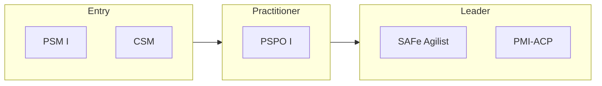

# Agile & Scrum certification roadmap

Scrum roles, product ownership and scaled agile.

| Certification | Issuer | Level | Good for | Free readiness check |
| --- | --- | --- | --- | --- |
| Professional Scrum Master I (PSM I) | Scrum.org | Entry | Scrum Master role; no course required | [Check readiness](https://edureify.com/certification/agile-scrum/psm-i/readiness-test?utm_source=github&utm_medium=repo&utm_campaign=gh_roadmaps_agile-scrum) |
| Certified ScrumMaster (CSM) | Scrum Alliance | Entry | Scrum Master role; includes a required course | [Check readiness](https://edureify.com/certification/agile-scrum/csm/readiness-test?utm_source=github&utm_medium=repo&utm_campaign=gh_roadmaps_agile-scrum) |
| Professional Scrum Product Owner I (PSPO I) | Scrum.org | Practitioner | Product Owner role | [Check readiness](https://edureify.com/certification/agile-scrum/pspo-i/readiness-test?utm_source=github&utm_medium=repo&utm_campaign=gh_roadmaps_agile-scrum) |
| SAFe Agilist | Scaled Agile | Leader | Leading agile at scale in large organizations | [Check readiness](https://edureify.com/certification/agile-scrum/safe-agilist/readiness-test?utm_source=github&utm_medium=repo&utm_campaign=gh_roadmaps_agile-scrum) |

## How to choose

- PSM I vs CSM: same role. CSM includes a mandatory course; PSM I is exam-only.
- Moving toward product? PSPO is the next step after a Scrum Master cert.
- SAFe matters mostly in large enterprises that already use it. Check job posts in your market.

## Official sources

Always confirm exam details, fees and eligibility with the issuer:

- [Scrum.org](https://www.scrum.org)
- [Scrum Alliance](https://www.scrumalliance.org)
- [Scaled Agile](https://scaledagile.com)

---
[Back to all roadmaps](../README.md)
