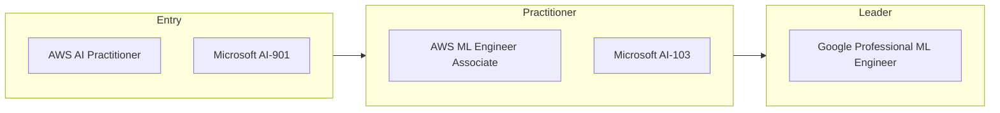

# AI & Machine Learning certification roadmap

Cloud AI certifications for builders and decision-makers.

| Certification | Issuer | Level | Good for | Free readiness check |
| --- | --- | --- | --- | --- |
| AWS Certified AI Practitioner | AWS | Entry | AI and generative AI basics for any role | [Check readiness](https://edureify.com/certification/artificial-intelligence-machine-learning?utm_source=github&utm_medium=repo&utm_campaign=gh_roadmaps_ai-ml) |
| Microsoft AI-901 (replaced AI-900 in 2026) | Microsoft | Entry | AI fundamentals on Azure | [Check readiness](https://edureify.com/certification/artificial-intelligence-machine-learning?utm_source=github&utm_medium=repo&utm_campaign=gh_roadmaps_ai-ml) |
| AWS Certified Machine Learning Engineer Associate | AWS | Practitioner | Building and deploying ML on AWS | [Check readiness](https://edureify.com/certification/artificial-intelligence-machine-learning?utm_source=github&utm_medium=repo&utm_campaign=gh_roadmaps_ai-ml) |
| Microsoft AI-103 (replaced AI-102 in 2026) | Microsoft | Practitioner | Building AI apps and agents on Azure | [Check readiness](https://edureify.com/certification/artificial-intelligence-machine-learning?utm_source=github&utm_medium=repo&utm_campaign=gh_roadmaps_ai-ml) |
| Google Professional Machine Learning Engineer | Google Cloud | Leader | Designing production ML systems | [Check readiness](https://edureify.com/certification/artificial-intelligence-machine-learning?utm_source=github&utm_medium=repo&utm_campaign=gh_roadmaps_ai-ml) |

## How to choose

- AI certs change fast. Microsoft retired AI-900 and AI-102 on June 30, 2026. Always check the current exam code.
- Builders: pick the platform you deploy on. Managers: a fundamentals cert plus real projects goes further.
- Data skills (cleaning, evaluation) matter more than any single cert in interviews.

## Official sources

Always confirm exam details, fees and eligibility with the issuer:

- [AWS](https://aws.amazon.com/certification/)
- [Microsoft](https://learn.microsoft.com/credentials/)
- [Google Cloud](https://cloud.google.com/learn/certification)

---
[Back to all roadmaps](../README.md)
