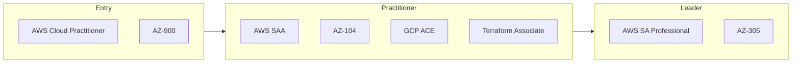

# Cloud Computing certification roadmap

AWS, Azure and Google Cloud paths, plus the tools most cloud teams use.

| Certification | Issuer | Level | Good for | Free readiness check |
| --- | --- | --- | --- | --- |
| AWS Certified Cloud Practitioner | AWS | Entry | Cloud basics for any role | [Check readiness](https://edureify.com/certification/cloud-computing/aws-cloud-practitioner/readiness-test?utm_source=github&utm_medium=repo&utm_campaign=gh_roadmaps_cloud) |
| Azure Fundamentals (AZ-900) | Microsoft | Entry | Cloud basics on Azure | [Check readiness](https://edureify.com/certification/cloud-computing/azure-fundamentals-az-900/readiness-test?utm_source=github&utm_medium=repo&utm_campaign=gh_roadmaps_cloud) |
| AWS Solutions Architect Associate | AWS | Practitioner | Designing systems on AWS | [Check readiness](https://edureify.com/certification/cloud-computing/aws-solution-architect/readiness-test?utm_source=github&utm_medium=repo&utm_campaign=gh_roadmaps_cloud) |
| Azure Administrator (AZ-104) | Microsoft | Practitioner | Running Azure environments | [Check readiness](https://edureify.com/certification/cloud-computing/azure-admin-az-104/readiness-test?utm_source=github&utm_medium=repo&utm_campaign=gh_roadmaps_cloud) |
| Google Associate Cloud Engineer | Google Cloud | Practitioner | Deploying and operating on GCP | [Check readiness](https://edureify.com/certification/cloud-computing/gcp-associate-cloud-engineer/readiness-test?utm_source=github&utm_medium=repo&utm_campaign=gh_roadmaps_cloud) |
| HashiCorp Terraform Associate | HashiCorp | Practitioner | Infrastructure as code | [Check readiness](https://edureify.com/certification/cloud-computing/terraform-associate/readiness-test?utm_source=github&utm_medium=repo&utm_campaign=gh_roadmaps_cloud) |
| AWS Solutions Architect Professional | AWS | Leader | Complex, multi-account AWS architecture | [Check readiness](https://edureify.com/certification/cloud-computing/aws-solutions-architect-professional/readiness-test?utm_source=github&utm_medium=repo&utm_campaign=gh_roadmaps_cloud) |
| Azure Solutions Architect (AZ-305) | Microsoft | Leader | Azure architecture design | [Check readiness](https://edureify.com/certification/cloud-computing/azure-solutions-architect-az-305/readiness-test?utm_source=github&utm_medium=repo&utm_campaign=gh_roadmaps_cloud) |

## How to choose

- Pick the cloud your current or target employer uses. Skills transfer, exam details don't.
- Associate-level certs are where most job posts start asking.
- Pair any cloud cert with Terraform or Kubernetes skills; that's what interviews test.

## Official sources

Always confirm exam details, fees and eligibility with the issuer:

- [AWS](https://aws.amazon.com/certification/)
- [Microsoft](https://learn.microsoft.com/credentials/)
- [Google Cloud](https://cloud.google.com/learn/certification)
- [HashiCorp](https://developer.hashicorp.com/certifications)

---
[Back to all roadmaps](../README.md)
