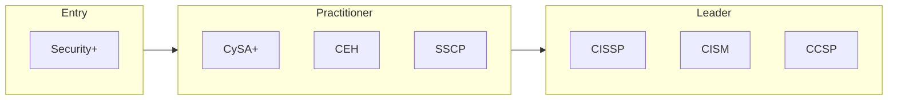

# Cybersecurity certification roadmap

From your first security job to leading a security program.

| Certification | Issuer | Level | Good for | Free readiness check |
| --- | --- | --- | --- | --- |
| CompTIA Security+ | CompTIA | Entry | First security role, broad fundamentals | [Check readiness](https://edureify.com/certification/cybersecurity/comptia-security-plus/readiness-test?utm_source=github&utm_medium=repo&utm_campaign=gh_roadmaps_cybersecurity) |
| CompTIA CySA+ | CompTIA | Practitioner | SOC and threat detection work | [Check readiness](https://edureify.com/certification/cybersecurity/comptia-cysa-plus/readiness-test?utm_source=github&utm_medium=repo&utm_campaign=gh_roadmaps_cybersecurity) |
| CEH | EC-Council | Practitioner | Offensive security basics, ethical hacking | [Check readiness](https://edureify.com/certification/cybersecurity/ceh/readiness-test?utm_source=github&utm_medium=repo&utm_campaign=gh_roadmaps_cybersecurity) |
| SSCP | ISC2 | Practitioner | Hands-on security operations and administration | [Check readiness](https://edureify.com/certification/cybersecurity/sscp/readiness-test?utm_source=github&utm_medium=repo&utm_campaign=gh_roadmaps_cybersecurity) |
| CISSP | ISC2 | Leader | Security management and architecture across 8 domains | [Check readiness](https://edureify.com/certification/cybersecurity/cissp/readiness-test?utm_source=github&utm_medium=repo&utm_campaign=gh_roadmaps_cybersecurity) |
| CISM | ISACA | Leader | Running an information security program | [Check readiness](https://edureify.com/certification/cybersecurity/cism/readiness-test?utm_source=github&utm_medium=repo&utm_campaign=gh_roadmaps_cybersecurity) |
| CCSP | ISC2 | Leader | Cloud security architecture and governance | [Check readiness](https://edureify.com/certification/cybersecurity/ccsp/readiness-test?utm_source=github&utm_medium=repo&utm_campaign=gh_roadmaps_cybersecurity) |

## How to choose

- Starting out: Security+ gives you the vocabulary most job posts expect.
- Hands-on or management? CySA+/CEH lean technical; CISM leans program management; CISSP covers both but is management-heavy.
- Leader-level certs require years of paid experience to be fully certified. Check the issuer's current rules before you book.

## Official sources

Always confirm exam details, fees and eligibility with the issuer:

- [CompTIA](https://www.comptia.org/certifications)
- [ISC2](https://www.isc2.org/certifications)
- [ISACA](https://www.isaca.org/credentialing)
- [EC-Council](https://www.eccouncil.org)

---
[Back to all roadmaps](../README.md)
