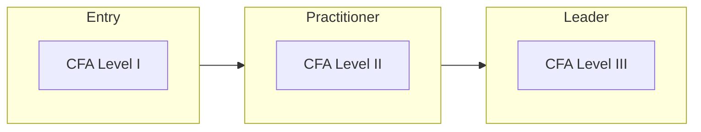

# Finance certification roadmap

Investment analysis and financial risk.

| Certification | Issuer | Level | Good for | Free readiness check |
| --- | --- | --- | --- | --- |
| CFA Level I | CFA Institute | Entry | Investment tools and ethics | [Check readiness](https://edureify.com/certification/finance/cfa-level-1/readiness-test?utm_source=github&utm_medium=repo&utm_campaign=gh_roadmaps_finance) |
| CFA Level II | CFA Institute | Practitioner | Asset valuation and analysis | [Check readiness](https://edureify.com/certification/finance/cfa-level-2/readiness-test?utm_source=github&utm_medium=repo&utm_campaign=gh_roadmaps_finance) |
| CFA Level III | CFA Institute | Leader | Portfolio management and wealth planning | [Check readiness](https://edureify.com/certification/finance/cfa-level-3/readiness-test?utm_source=github&utm_medium=repo&utm_campaign=gh_roadmaps_finance) |

## How to choose

- Each CFA level takes many months of study; plan the full journey before you start.
- The charter also needs qualifying work experience. Check CFA Institute's current requirements.
- Risk roles often pair CFA with FRM (GARP).

## Official sources

Always confirm exam details, fees and eligibility with the issuer:

- [CFA Institute](https://www.cfainstitute.org)
- [GARP (FRM)](https://www.garp.org)

---
[Back to all roadmaps](../README.md)
