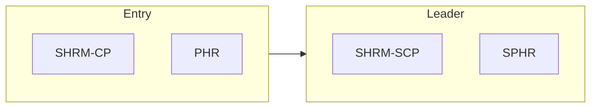

# Human Resources certification roadmap

HR generalist to strategic HR leadership.

| Certification | Issuer | Level | Good for | Free readiness check |
| --- | --- | --- | --- | --- |
| SHRM-CP | SHRM | Entry / Practitioner | Operational HR roles | [Check readiness](https://edureify.com/certification/human-resources/shrm-cp/readiness-test?utm_source=github&utm_medium=repo&utm_campaign=gh_roadmaps_hr) |
| PHR | HRCI | Entry / Practitioner | HR operations and US employment law | [Check readiness](https://edureify.com/certification/human-resources/phr/readiness-test?utm_source=github&utm_medium=repo&utm_campaign=gh_roadmaps_hr) |
| SHRM-SCP | SHRM | Leader | Strategic HR leadership | [Check readiness](https://edureify.com/certification/human-resources/shrm-scp/readiness-test?utm_source=github&utm_medium=repo&utm_campaign=gh_roadmaps_hr) |
| SPHR | HRCI | Leader | Senior HR policy and strategy | [Check readiness](https://edureify.com/certification/human-resources/sphr/readiness-test?utm_source=github&utm_medium=repo&utm_campaign=gh_roadmaps_hr) |

## How to choose

- SHRM certs focus on competencies and judgment; HRCI certs focus on knowledge and law.
- Senior certs (SHRM-SCP, SPHR) fit people who set HR strategy, not just run processes.
- Requirements change; check the issuer's site before applying.

## Official sources

Always confirm exam details, fees and eligibility with the issuer:

- [SHRM](https://www.shrm.org/credentials)
- [HRCI](https://www.hrci.org)

---
[Back to all roadmaps](../README.md)
