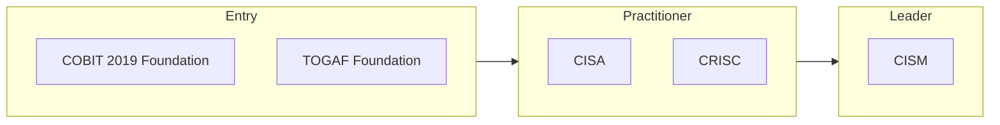

# IT Audit & Governance certification roadmap

IT audit, risk, governance and enterprise architecture.

| Certification | Issuer | Level | Good for | Free readiness check |
| --- | --- | --- | --- | --- |
| COBIT 2019 Foundation | ISACA | Entry | IT governance framework basics | [Check readiness](https://edureify.com/certification/enterprise-architecture-it-governance/cobit-2019-foundation/readiness-test?utm_source=github&utm_medium=repo&utm_campaign=gh_roadmaps_it-audit-governance) |
| TOGAF 10 Foundation | The Open Group | Entry | Enterprise architecture basics | [Check readiness](https://edureify.com/certification/enterprise-architecture-it-governance/togaf-10-foundation/readiness-test?utm_source=github&utm_medium=repo&utm_campaign=gh_roadmaps_it-audit-governance) |
| CISA | ISACA | Practitioner | IT audit, controls and assurance | [Check readiness](https://edureify.com/certification/cybersecurity/cisa/readiness-test?utm_source=github&utm_medium=repo&utm_campaign=gh_roadmaps_it-audit-governance) |
| CRISC | ISACA | Practitioner | IT risk identification and response | [Check readiness](https://edureify.com/certification/cybersecurity/crisc/readiness-test?utm_source=github&utm_medium=repo&utm_campaign=gh_roadmaps_it-audit-governance) |
| CISM | ISACA | Leader | Security governance and program leadership | [Check readiness](https://edureify.com/certification/cybersecurity/cism/readiness-test?utm_source=github&utm_medium=repo&utm_campaign=gh_roadmaps_it-audit-governance) |

## How to choose

- CISA is the standard for IT auditors; it's often the first cert audit teams ask for.
- CRISC suits risk and GRC roles more than audit roles.
- ISACA certs require years of relevant experience to be fully certified. Check current rules.

## Official sources

Always confirm exam details, fees and eligibility with the issuer:

- [ISACA](https://www.isaca.org/credentialing)
- [The Open Group](https://www.opengroup.org/certifications)

---
[Back to all roadmaps](../README.md)
