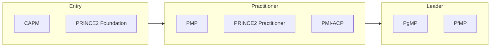

# Project Management certification roadmap

From coordinating tasks to running programs and portfolios.

| Certification | Issuer | Level | Good for | Free readiness check |
| --- | --- | --- | --- | --- |
| CAPM | PMI | Entry | Starting a project career | [Check readiness](https://edureify.com/certification/project-management/capm/readiness-test?utm_source=github&utm_medium=repo&utm_campaign=gh_roadmaps_project-management) |
| PRINCE2 Foundation | PeopleCert | Entry | Structured method, common in UK/EU/public sector | [Check readiness](https://edureify.com/certification/project-management/prince2-foundation-v7/readiness-test?utm_source=github&utm_medium=repo&utm_campaign=gh_roadmaps_project-management) |
| PMP | PMI | Practitioner | Leading projects; widely requested worldwide | [Check readiness](https://edureify.com/certification/project-management/pmp/readiness-test?utm_source=github&utm_medium=repo&utm_campaign=gh_roadmaps_project-management) |
| PRINCE2 Practitioner | PeopleCert | Practitioner | Applying PRINCE2 on real projects | [Check readiness](https://edureify.com/certification/project-management/prince2-practitioner-v7/readiness-test?utm_source=github&utm_medium=repo&utm_campaign=gh_roadmaps_project-management) |
| PMI-ACP | PMI | Practitioner | Agile project delivery | [Check readiness](https://edureify.com/certification/project-management/pmi-acp/readiness-test?utm_source=github&utm_medium=repo&utm_campaign=gh_roadmaps_project-management) |
| PgMP | PMI | Leader | Managing programs of related projects | [Check readiness](https://edureify.com/certification/project-management/pgmp/readiness-test?utm_source=github&utm_medium=repo&utm_campaign=gh_roadmaps_project-management) |
| PfMP | PMI | Leader | Portfolio management and strategy | [Check readiness](https://edureify.com/certification/project-management/pfmp/readiness-test?utm_source=github&utm_medium=repo&utm_campaign=gh_roadmaps_project-management) |

## How to choose

- PMP requires documented project-leading experience plus 35 hours of PM education. CAPM is the route if you don't have that yet.
- PRINCE2 is a method; PMP is broader practice. Many people hold both.
- Program and portfolio certs (PgMP, PfMP) make sense only after years of PM leadership.

## Official sources

Always confirm exam details, fees and eligibility with the issuer:

- [PMI](https://www.pmi.org/certifications)
- [PeopleCert (PRINCE2)](https://www.peoplecert.org)

---
[Back to all roadmaps](../README.md)
